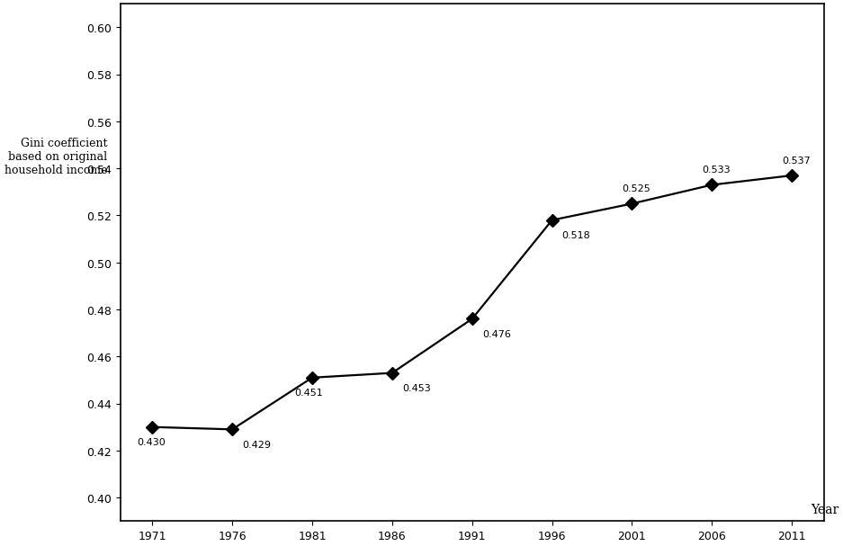
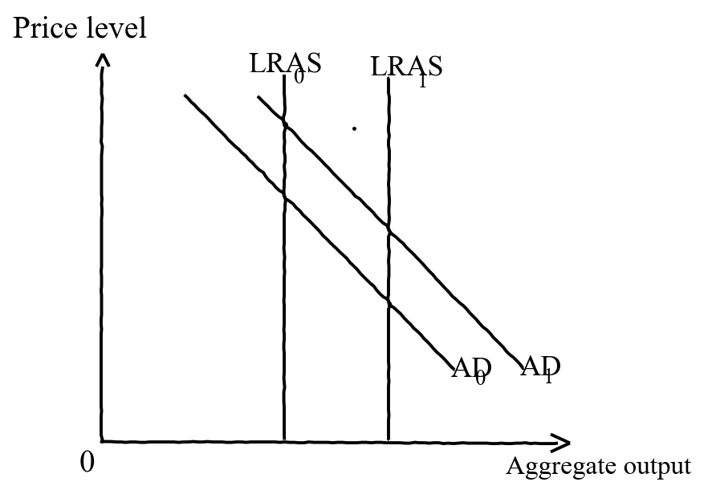

# 2017 DSE 經濟 試卷一（英文卷）— 題目庫

> 來源：2017-DSE-ECON PAPER 1（dsepaper_hk\經濟\2017\…Past Paper Paper 1.pdf；英文卷，唔用卷一.pdf）　｜　多項選擇題 45 題，每題等分　｜　一小時完卷（8:30 am – 9:30 am）
> 說明：已移除頁碼、試卷標頭、網站水印等雜訊。**本檔為題目庫（零答案）**，只含題目清洗 + 建議標籤。
> 含圖題目嵌入**電子重繪向量圖**（存於 `2017_P1_images/`）。原卷頁面影像只作對照、不上網。
> **圖進度（誠實）**：10 張之中 **2/10 已過 §9.4＋抗鋸齒容差並嵌圖**（Q21 已收貨；Q29 dir1=99.959／dir2=100／maxdev=2.24／p99.9=1.92）。其餘 **Q24／Q25／Q32／Q35／Q39／Q40／Q42 待重繪**（已撤 embed）；**Q30 商標無法重繪**（無圖）。**唔用 crop、唔用中文改寫圖選項**。詳見 `2017_P1_fig_audit.md`。

---

## 甲部（第 1–30 題）

## 第 1 題

【建議標籤】

- 卷別/部分：Paper 1
- 課題：#基本經濟問題 #市場機制

【題目內容】

The operator of a canteen in the government headquarters decides to sell sushi and not burgers anymore because the former can earn a higher profit. This is an example of using \_\_\_\_\_\_ to solve the problem of \_\_\_\_\_\_.

- A. government command ...... ‘what to produce’
- B. government command ...... ‘for whom to produce’
- C. market mechanism ...... ‘what to produce’
- D. market mechanism ...... ‘for whom to produce’

---

## 第 2 題

【建議標籤】

- 卷別/部分：Paper 1
- 課題：#利息 #稀少性

【題目內容】

Which of the following statements about interest is correct?

- A. Without money, interest does not exist.
- B. Without inflation, interest does not exist.
- C. Without scarcity, interest does not exist.
- D. Interest is the compensation paid to the borrower for delayed consumption.

---

## 第 3 題

【建議標籤】

- 卷別/部分：Paper 1
- 課題：#公營物品

【題目內容】

A public good

- A. is a good with zero marginal cost of production.
- B. can only be provided by the government.
- C. cannot be protected by private property rights.
- D. allows concurrent consumption by many individuals.

---

## 第 4 題

【建議標籤】

- 卷別/部分：Paper 1
- 課題：#機會成本 #成本

【題目內容】

Which of the following would be the loss(es) of delaying the completion of a new railway to an economy?
(1) the travel time of passengers that would have been saved by the new railway during the period of delay
(2) the damage to the corporate image of the railway constructor for the delay
(3) the nuisance to the shops and residents nearby during the period of delay

- A. (1) only
- B. (2) only
- C. (3) only
- D. (1), (2) and (3)

---

## 第 5 題

【建議標籤】

- 卷別/部分：Paper 1
- 課題：#公司種類

【題目內容】

Alan and his partners turned their partnership into a private limited company. After the change, the firm will

- A. have more capital for development.
- B. have a lower average production cost.
- C. enjoy a lower profits tax rate.
- D. have a separate legal entity.

---

## 第 6 題

【建議標籤】

- 卷別/部分：Paper 1
- 課題：#債券 #股份

【題目內容】

The government launched the Silver Bond for Hong Kong residents aged 65 or above. Bondholders will be paid interest at a rate linked to inflation in Hong Kong, subject to a minimum rate of 2% per year. Bondholders may sell their bonds at original price to the government before maturity.

Which of the following statements about the Silver Bond is/are correct?
(1) The risk of holding the Silver Bond is lower than that of the shares of a listed company.
(2) The return of the Silver Bond would increase during inflation while the return of the shares of a listed company would not.
(3) The interest received by Silver Bond holders is higher than the dividend received by the shareholders of a listed company.

- A. (1) only
- B. (2) only
- C. (3) only
- D. (1), (2) and (3)

---

## 第 7 題

【建議標籤】

- 卷別/部分：Paper 1
- 課題：#勞動生產力

【題目內容】

Certain restaurants in China found that they can introduce robots to replace some workers in serving customers without reducing their output. This will

- A. increase the quantity supplied of restaurant workers.
- B. increase the labour productivity of those restaurants.
- C. decrease the geographical mobility of restaurant workers.
- D. decrease the occupational mobility of restaurant workers.

---

## 第 8 題

【建議標籤】

- 卷別/部分：Paper 1
- 課題：#利潤 #成本 #完全競爭

【題目內容】

The following table shows the cost-output relationship of a price-taker.

| Output (units) | Average cost ($) |
|---|---|
| 5 | 10 |
| 6 | 11 |
| 7 | 12 |
| 8 | 13 |
| 9 | 14 |

The market price is \$20. Suppose the average cost has increased by \$2 for every unit of output. The profit of the firm will \_\_\_\_\_\_.

- A. increase by \$16
- B. increase by \$14
- C. decrease by \$16
- D. decrease by \$14

---

## 第 9 題

【建議標籤】

- 卷別/部分：Paper 1
- 課題：#業務擴展

【題目內容】

Giordano International Limited is a retailer of casual wear. It has launched the Giordano Ladies, which provides luxury clothes and suits for ladies. It is an example of \_\_\_\_\_\_ expansion.

- A. horizontal
- B. vertical
- C. lateral
- D. conglomerate

---

## 第 10 題

【建議標籤】

- 卷別/部分：Paper 1
- 課題：#固定成本 #可變成本

【題目內容】

An art centre extends its business hours for one hour in order to offer more painting classes. Which of the following are variable costs involved in the extra hour of operation?
(1) salary of the accountant
(2) electricity fee
(3) expense on paints
(4) rental payment

- A. (1) and (4) only
- B. (2) and (3) only
- C. (1), (2) and (4) only
- D. (1), (2), (3) and (4)

---

## 第 11 題

【建議標籤】

- 卷別/部分：Paper 1
- 課題：#勞動供給 #勞動生產力

【題目內容】

The input-output relationship of a firm is as follows:

| | Year 1 | Year 2 |
|---|---|---|
| Number of workers | 30 | 35 |
| Number of working hours per worker per day | 10 | 8 |
| Quantity of output (units) | 3 000 | 2 900 |

Based on the above information, labour supply \_\_\_\_\_\_ and average labour productivity \_\_\_\_\_\_.

- A. rises ...... rises
- B. rises ...... falls
- C. falls ...... rises
- D. falls ...... falls

---

## 第 12 題

【建議標籤】

- 卷別/部分：Paper 1
- 課題：#價格機能

【題目內容】

A famous artist, Tsz-Wah, held a show. Many people complained that they could not buy a ticket. Ticket touts resold the tickets on the Internet and some buyers paid a price higher than HK\$10 000 for a ticket.

The above case illustrates the \_\_\_\_\_\_ function of price because \_\_\_\_\_\_.

- A. rationing ...... the tickets are rationed to the highest-valued buyers
- B. rationing ...... demand will be reduced by a higher price
- C. allocative ...... more profits can be earned with a higher price
- D. allocative ...... more resources should be allocated to the producer to raise the supply

---

## 第 13 題

【建議標籤】

- 卷別/部分：Paper 1
- 課題：#需求定律

【題目內容】

Which of the following is **INCONSISTENT** with the law of demand?

- A. The abolishment of per unit import tariff on garment results in a rise in the quality of imported garments.
- B. Live fishes sold in a market near the fish farm have a higher price than frozen fishes sold in a faraway market.
- C. The ratio of high-quality white wine sold to total white wine sold remains unchanged when the government imposes an ad valorem tax on white wine.
- D. Developers tend to build higher-quality housing units on a piece of land with a good view.

---

## 第 14 題

【建議標籤】

- 卷別/部分：Paper 1
- 課題：#需求

【題目內容】

Which of the following situations would most likely lead to an increase in the demand for iPhone produced by Apple Inc.?

- A. A technological breakthrough in the battery industry reduces its production cost.
- B. People expect the next model of iPhone will have more innovative features.
- C. A model of Samsung smartphone is banned by many airlines.
- D. Apple Inc. reduces the selling price of iPhone.

---

## 第 15 題

【建議標籤】

- 卷別/部分：Paper 1
- 課題：#彈性

【題目內容】

Refer to the following conversation between Mandy and Shirley.

Mandy: I like coffee very much! No matter how its price changes, I always buy the same amount of coffee every week!

Shirley: I like coffee very much too! No matter how its price changes, I always spend the same amount of money on coffee every week!

Based on their conversation, Mandy’s demand for coffee is \_\_\_\_\_\_ and Shirley’s demand for coffee is \_\_\_\_\_\_.

- A. perfectly inelastic ...... perfectly inelastic
- B. perfectly inelastic ...... unitarily elastic
- C. unitarily elastic ...... perfectly inelastic
- D. unitarily elastic ...... unitarily elastic

---

## 第 16 題

【建議標籤】

- 卷別/部分：Paper 1
- 課題：#從量稅 #供求

【題目內容】

Refer to the following supply and demand schedules for Good X.

| Unit price ($) | 6 | 7 | 8 | 9 | 10 | 11 | 12 | 13 |
|---|---|---|---|---|---|---|---|---|
| Quantity demanded | 140 | 130 | 120 | 110 | 100 | 90 | 80 | 70 |
| Quantity supplied | 60 | 70 | 80 | 90 | 100 | 110 | 120 | 130 |

If the government imposed a \$2 per unit tax on Good X,

- A. sellers’ revenue net of tax would become \$990.
- B. tax burden borne by the sellers would be \$90.
- C. the total tax revenue would be \$200.
- D. buyers’ total expenditure on Good X would decrease by \$40.

---

## 第 17 題

【建議標籤】

- 卷別/部分：Paper 1
- 課題：#劣等物品 #供求

【題目內容】

Suppose Good Y is an inferior good. When people’s income rises and the production cost of Good Y increases, the equilibrium price of Good Y \_\_\_\_\_\_.

- A. will increase
- B. will decrease
- C. will remain unchanged
- D. may increase or decrease

---

## 第 18 題

【建議標籤】

- 卷別/部分：Paper 1
- 課題：#價格上限 #市場干預

【題目內容】

Suppose the government imposed an effective rent control on living units. Which of the following would **LEAST** likely occur?

- A. There would be a shortage of living units.
- B. Black market would emerge.
- C. Poor people would be able to rent a living unit more easily.
- D. Landlords would have a lower incentive to renovate their living units for rent.

---

## 第 19 題

【建議標籤】

- 卷別/部分：Paper 1
- 課題：#壟斷性競爭 #市場結構

【題目內容】

Which of the following statements about monopolistic competition are correct?
(1) There can be a few or many buyers and sellers in the market.
(2) The sellers are price searchers.
(3) The goods and services provided by the sellers are homogeneous.
(4) There are free entry and exit in the market.

- A. (1) and (3) only
- B. (1) and (4) only
- C. (2) and (3) only
- D. (2) and (4) only

---

## 第 20 題

【建議標籤】

- 卷別/部分：Paper 1
- 課題：#收入不均

【題目內容】

Li Ka Shing Foundation gave HK\$5 000 to each 2017 HKDSE candidate living in those remote districts with lower average household income. Which of the following statements about this unconditional gift is correct?

- A. It reduces the income inequality as a larger portion of the receivers of the gift are from lower income group.
- B. It increases the income inequality as it is unfair to the candidates living in the non-remote districts.
- C. As the money is given to all candidates living in those remote districts, income distribution remains unchanged.
- D. It helps equalising opportunities as those candidates will study harder to improve their exam results.

---

## 第 21 題

【建議標籤】

- 卷別/部分：Paper 1
- 課題：#堅尼系數 #收入不均

【題目內容】

The following diagram shows the Gini coefficient of Hong Kong based on original household income.

Based on the above diagram, we can conclude that

- A. the income level of Hong Kong people increased.
- B. income for high income household increased while income for low income household decreased.
- C. the welfare policy failed to reduce the income inequality.
- D. income gap had been widening.

---

## 第 22 題

【建議標籤】

- 卷別/部分：Paper 1
- 課題：#勞工流動性 #勞動供給

【題目內容】

The Work Incentive Transport Subsidy Scheme helps low-income earners reduce their cost of travelling to and from work and encourages them to get a job. Workers meeting certain criteria, such as monthly income and asset limits, are eligible to get the subsidy.

Which of the following would likely occur after the implementation of this scheme?
(1) Labour supply would increase.
(2) Labour productivity would increase.
(3) Geographical mobility of labour would increase.
(4) Income inequality would decrease.

- A. (1) and (2) only
- B. (3) and (4) only
- C. (1), (3) and (4) only
- D. (2), (3) and (4) only

---

## 第 23 題

【建議標籤】

- 卷別/部分：Paper 1
- 課題：#價格下限 #消費者剩餘

【題目內容】

If the government raises the effective price floor on Good X and at the same time the price of its substitute increases, the consumer surplus in the market of Good X \_\_\_\_\_\_.

- A. will increase
- B. will decrease
- C. will remain unchanged
- D. may increase or decrease

---

## 第 24 題

【建議標籤】

- 卷別/部分：Paper 1
- 課題：#限額 #市場干預

【題目內容】

Refer to the following supply-demand diagram of a good with a quota set at $Q_1$ by the government.

Which of the following will be the results of a reduction in quota on the good?
(1) The total expenditure on the good may increase.
(2) The consumer surplus will decrease.
(3) The total social surplus may increase.

- A. (1) and (2) only
- B. (1) and (3) only
- C. (2) and (3) only
- D. (1), (2) and (3)

---

## 第 25 題

【建議標籤】

- 卷別/部分：Paper 1
- 課題：#國民收入 #GDP

【題目內容】

The following diagram shows a production chain of watches in an economy:

The contribution of the local watch manufacturers to the economy’s GDP at market prices is \_\_\_\_\_\_.

- A. \$220
- B. \$240
- C. \$350
- D. \$400

---

## 第 26 題

【建議標籤】

- 卷別/部分：Paper 1
- 課題：#宏觀指標 #GDP

【題目內容】

The following table shows some data of an economy.

| Growth rate | 2015 | 2016 |
|---|---|---|
| GDP | −3% | −2% |
| Price level | 1% | 0% |
| Population | 4% | 2% |

Which of the following statements about the economy is correct?

- A. Real GDP in 2016 decreases.
- B. Per capita GDP in 2016 increases.
- C. The price level in 2016 decreases.
- D. The growth rate of real GDP in 2016 is lower than that in 2015.

---

## 第 27 題

【建議標籤】

- 卷別/部分：Paper 1
- 課題：#勞動力 #失業率

【題目內容】

The government launches ‘Admission Scheme for the Second Generation of Chinese Hong Kong Permanent Residents’（輸入中國籍香港永久性居民第二代計劃）in order to meet the challenge of ageing population and declining workforce.

If some second-generation of Hong Kong permanent residents returned to Hong Kong to fill up the posts which have been vacant for a long time, Hong Kong’s labour force would \_\_\_\_\_\_ and the unemployment rate would \_\_\_\_\_\_.

- A. rise ...... remain unchanged
- B. rise ...... fall
- C. fall ...... remain unchanged
- D. fall ...... fall

---

## 第 28 題

【建議標籤】

- 卷別/部分：Paper 1
- 課題：#總需求

【題目內容】

The aggregate demand curve of Hong Kong will shift to the left if

- A. the implicit GDP deflator rises continuously.
- B. the government raises the retirement age of all civil servants.
- C. the number of tourists from the Mainland decreases.
- D. the Mainland stock market booms.

---

## 第 29 題

【建議標籤】

- 卷別/部分：Paper 1
- 課題：#AD-AS

【題目內容】

The diagram above shows the aggregate demand curves and long run aggregate supply curves of an economy. Which of the following best explains the above changes?

- A. a decrease in people’s desire to save
- B. an enhancement in production technology
- C. an increase in national income of the economy’s trading partners
- D. an increase in government subsidy on private research and development

---

## 第 30 題

【建議標籤】

- 卷別/部分：Paper 1
- 課題：#貨幣 #銀行乘數

【題目內容】

Electronic payment systems allow customers to pay without cash. ApplePay, Visa payWave and MasterCard paypass are some of the examples.

When more shops accept these electronic payment systems as a method of payment,
(1) their cost of handling coins and notes will fall.
(2) the actual banking multiplier may increase.
(3) transactions demand for money will increase.

- A. (1) and (2) only
- B. (1) and (3) only
- C. (2) and (3) only
- D. (1), (2) and (3)

---

## 乙部（第 31–45 題）

## 第 31 題

【建議標籤】

- 卷別/部分：Paper 1
- 課題：#銀行 #存款創造

【題目內容】

The following table shows the balance sheet of a banking system.

| Assets (\$) | | Liabilities (\$) | |
|---|---|---|---|
| Reserves | 300 | Deposits | 900 |
| Loans | 600 | | |

Suppose the public does not hold cash and the required reserve ratio is reduced to 25%. After deposit creation, the amount of loans in the banking system is \$750. Which of the following statements about the banking system is correct?

- A. The money supply increases by \$300.
- B. The actual banking multiplier is 3.5.
- C. The deposits increase by \$600.
- D. Bank reserves are \$450.

---

## 第 32 題

【建議標籤】

- 卷別/部分：Paper 1
- 課題：#貨幣市場

【題目內容】

The diagram below shows the money demand and supply curves of an economy. The original equilibrium point is at E.

Suppose the risk of holding interest bearing assets (such as bonds) increases and the central bank reduces the discount rate. The new equilibrium point will be at \_\_\_\_\_\_.

- A. A
- B. B
- C. C
- D. D

---

## 第 33 題

【建議標籤】

- 卷別/部分：Paper 1
- 課題：#貨幣供應

【題目內容】

Refer to the following data about Hong Kong’s money supply.

| Components | \$ billion |
|---|---|
| Total issue of legal tender | 300 |
| Legal tender held by all authorised institutions | 80 |
| Demand deposits | 100 |
| All types of deposits with licensed banks and negotiable certificates of deposit issued by licensed banks (other than those held by authorised institutions) | 3 000 |

The money supply M2 is \_\_\_\_\_\_.

- A. \$320 billion
- B. \$3 180 billion
- C. \$3 220 billion
- D. \$3 300 billion

---

## 第 34 題

【建議標籤】

- 卷別/部分：Paper 1
- 課題：#通脹

【題目內容】

When there is unexpected inflation, which of the following individual(s) will lose?

- A. A firm owner paying his workers a fixed wage
- B. A flat owner charging a rental with adjustment according to the change in price level
- C. A retired civil servant receiving a fixed monthly pension
- D. All of the above individuals will lose because the purchasing power of money will be lower.

---

## 第 35 題

【建議標籤】

- 卷別/部分：Paper 1
- 課題：#稅收 #累退稅

【題目內容】

Which of the following diagrams describe a regressive tax?

- A. (1) and (2) only
- B. (1) and (3) only
- C. (2) and (4) only
- D. (3) and (4) only

---

## 第 36 題

【建議標籤】

- 卷別/部分：Paper 1
- 課題：#貨幣數量理論

【題目內容】

According to the quantity theory of money, if a central bank increases money supply,

- A. the price level will increase.
- B. real output will remain constant.
- C. nominal output will increase.
- D. the unemployment rate will decrease.

---

## 第 37 題

【建議標籤】

- 卷別/部分：Paper 1
- 課題：#財政政策 #貨幣政策

【題目內容】

Which of the following policies would most likely lead to a drop in aggregate output?

- A. The government bought bonds from the public and raised the tax allowance at the same time.
- B. The government sold bonds to the public and reduced transfer payment to the poor at the same time.
- C. The government reduced required reserve ratio and raised the progressivity of income tax at the same time.
- D. The government increased the discount rate and lowered profits tax rate at the same time.

---

## 第 38 題

【建議標籤】

- 卷別/部分：Paper 1
- 課題：#財政政策 #貨幣政策

【題目內容】

To reduce fiscal deficits, the government may adopt either contractionary fiscal policy (e.g. increase taxes and/or decrease fiscal spending) or expansionary monetary policy (e.g. finance the deficits by printing money).

Refer to a situation of an upward-sloping short run aggregate supply curve. Which of the following are the advantages of using expansionary monetary policy over contractionary fiscal policy to reduce fiscal deficits?
(1) The employment level will be higher.
(2) The purchasing power of money will be higher.
(3) The real output level will be higher.

- A. (1) and (2) only
- B. (1) and (3) only
- C. (2) and (3) only
- D. (1), (2) and (3)

---

## 第 39 題

【建議標籤】

- 卷別/部分：Paper 1
- 課題：#AD-AS #緊縮缺口

【題目內容】

The diagram below shows the aggregate demand curve, the short run aggregate supply curve and the long run aggregate supply curve of an economy.

Suppose the economy initially operates at $E_1$ and the total import value equals total export value. If the government decreases the social security assistance to the elderly, in short run, the deflationary (output) gap will be \_\_\_\_\_\_ and there will be a \_\_\_\_\_\_.

- A. narrower ...... trade surplus
- B. wider ...... trade deficit
- C. narrower ...... trade deficit
- D. wider ...... trade surplus

---

## 第 40 題

【建議標籤】

- 卷別/部分：Paper 1
- 課題：#AD-AS #財政政策

【題目內容】

In his 2016-17 Budget, the Financial Secretary proposed to waive business registration fees for 2016-17. At the same time, the personal basic tax allowance was raised from \$120 000 to \$132 000. Which of the following best illustrates the effect of the above changes on the price and output levels?

- A.
- B.
- C.
- D.

---

## 第 41 題

【建議標籤】

- 卷別/部分：Paper 1
- 課題：#國際收支

【題目內容】

Which of the following transactions will be included in the calculation of the balance of payments of Hong Kong?
(1) A Mainland resident who owns an apartment in Hong Kong receives rental payment from his tenant.
(2) A Japanese resident sells the shares of a Hong Kong firm to a Korean resident.
(3) A Hong Kong resident buys an air ticket to London from a Hong Kong based airline.
(4) An Indonesian who works in Hong Kong as a domestic helper remits money to her husband who lives in Indonesia.

- A. (1) and (3) only
- B. (1) and (4) only
- C. (2) and (3) only
- D. (2) and (4) only

---

## 第 42 題

【建議標籤】

- 卷別/部分：Paper 1
- 課題：#限額 #開放經濟

【題目內容】

A small open economy increases the import quota for Good X. Which of the following diagrams best illustrates the effect of this change?

- A.
- B.
- C.
- D.

---

## 第 43 題

【建議標籤】

- 卷別/部分：Paper 1
- 課題：#比較優勢 #貿易條件

【題目內容】

The following table shows the number of man-hours required by Country A and Country B in the production of toys and watches.

| | 1 unit of toys | 1 unit of watches |
|---|---|---|
| Country A | 4 | 8 |
| Country B | 5 | 20 |

Suppose the transportation cost for 1 unit of toys is 0.1 units of watches and it is borne by the exporting country. Which of the following would be a mutually beneficial terms of trade between Country A and Country B?

- A. 1 unit of toys = 0.3 units of watches
- B. 1 unit of toys = 0.4 units of watches
- C. 1 unit of toys = 2.5 units of watches
- D. 1 unit of toys = 6 units of watches

---

## 第 44 題

【建議標籤】

- 卷別/部分：Paper 1
- 課題：#匯率

【題目內容】

| Date | Exchange rates |
|---|---|
| 22 November 2015 | US\$1 = RMB¥6.39 |
| 22 November 2016 | US\$1 = RMB¥6.89 |

The above change in the exchange rate between the US Dollar and the Renminbi would lead to
(1) a decrease in the number of Chinese tourists to the US.
(2) a decrease in the competitiveness of US exports to China.
(3) an increase in the total value of US exports to China (in terms of the US Dollar).

- A. (1) and (2) only
- B. (1) and (3) only
- C. (2) and (3) only
- D. (1), (2) and (3)

---

## 第 45 題

【建議標籤】

- 卷別/部分：Paper 1
- 課題：#聯繫匯率

【題目內容】

Under the linked exchange rate system of Hong Kong, which of the following statements is correct?

- A. The non-bank public can sell their Hong Kong dollars to the Hong Kong Monetary Authority in exchange for US dollars at any time.
- B. It enables the Hong Kong Monetary Authority to carry out an expansionary monetary policy to stimulate private investment.
- C. The market exchange rate of the US Dollar against the HK Dollar is fixed at US\$1 = HK\$7.8.
- D. There would be a downward pressure on the consumer price indices of Hong Kong when the Renminbi continuously depreciates against the US Dollar.
