# 2020 DSE 經濟 試卷一（英文卷）— 題目庫

> 來源：2020-DSE-ECON PAPER 1（dsepaper_hk\經濟\2020\…Paper 1.pdf）　｜　多項選擇題 45 題，每題等分　｜　一小時完卷（8:30 am – 9:30 am）
> 說明：已移除頁碼、試卷標頭、網站水印等雜訊；公式重排為 LaTeX。**本檔為題目庫（零答案）**，只含題目清洗 + 建議標籤。
> 含圖題目已嵌入**電子重繪向量圖**（存於 `2020_P1_images/`，PNG＋真 SVG）。12 張在庫：其中 **7 張有 §9.4 雙向數字**（Q16／18／20／28／31／36／43，dir1/dir2≥99.5%，maxdev 2.00–2.83 屬 AA 容差）＋**5 張語義核／樣板核**（Q6／14／21／22／26）。逐張依據見 `2020_P1_fig_audit.md`。原卷頁面只作對照、不上網。唔用 crop。

---

## 甲部（第 1–30 題）

## 第 1 題

【建議標籤】

- 卷別/部分：Paper 1
- 課題：#經濟制度 #價格機制

【題目內容】

If a command economy turns into a market-oriented economy,
(1) the income distribution of the economy will be more uneven.
(2) more resources will be allocated by price mechanism.
(3) people will have private property rights over all resources.

- A. (1) only
- B. (2) only
- C. (3) only
- D. (1), (2) and (3)

---

## 第 2 題

【建議標籤】

- 卷別/部分：Paper 1
- 課題：#公營物品 #私營物品

【題目內容】

In Lunar New Year, tourists reserve tables in waterfront restaurants to enjoy firework display. The firework display is a \_\_\_\_\_\_ because \_\_\_\_\_\_.

- A. public good ...... the government pays for the firework display
- B. public good ...... one individual's consumption will not reduce its availability to others
- C. private good ...... private firms have to use resources to produce the firework display
- D. private good ...... the seats in waterfront restaurants are excludable in consumption

---

## 第 3 題

【建議標籤】

- 卷別/部分：Paper 1
- 課題：#物物交換 #利息

【題目內容】

Which of the following may exist in a barter economy?
(1) specialisation
(2) inflation
(3) interest

- A. (1) and (2) only
- B. (1) and (3) only
- C. (2) and (3) only
- D. (1), (2) and (3)

---

## 第 4 題

【建議標籤】

- 卷別/部分：Paper 1
- 課題：#債券 #股份

【題目內容】

Some small investors prefer debentures to shares. Which of the following is a possible reason for that?

- A. The return of debentures is generally higher than that of shares.
- B. The price of shares may rise while that of debentures is fixed.
- C. Shareholders need to spend time managing the company but debenture holders do not.
- D. Companies have obligation to redeem debentures but they have no such obligation for shares.

---

## 第 5 題

【建議標籤】

- 卷別/部分：Paper 1
- 課題：#公司種類 #流動性

【題目內容】

If a public limited company in Hong Kong gets listed on the stock exchange,

- A. it will face a higher profits tax rate.
- B. it can no longer keep its accounting information confidential.
- C. its shareholders will enjoy higher liquidity of their assets.
- D. it will enjoy economies of scale.

---

## 第 6 題

【建議標籤】

- 卷別/部分：Paper 1
- 課題：#生產要素回報 #企業家

【題目內容】

Refer to the following dialogue.

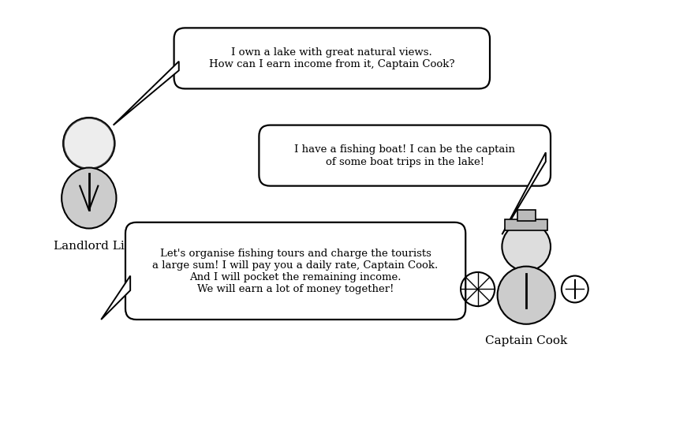

Given the return of land is rent, the return of labour is wage, the return of capital is interest while the return of entrepreneur is profit. The income earned by Captain Cook consists of \_\_\_\_\_\_ while the remaining income earned by Landlord Li consists of \_\_\_\_\_\_.

- A. wage ...... profit
- B. interest ...... rent and profit
- C. wage and interest ...... rent
- D. wage and interest ...... rent and profit

---

## 第 7 題

【建議標籤】

- 卷別/部分：Paper 1
- 課題：#規模經濟 #外部經濟

【題目內容】

Tai On Building（太安樓）in eastern Hong Kong Island is well-known as a 'foodie paradise'. A variety of street snacks such as cart noodles, egg waffles, dumplings and mango mochi are sold by numerous small vendors. Customers from different districts fill their stomachs at Tai On Building.

Based on the above information, street snack vendors at Tai On Building can \_\_\_\_\_\_.

- A. enjoy internal economies of scale
- B. enjoy external economies of scale
- C. suffer internal diseconomies of scale
- D. suffer external diseconomies of scale

---

## 第 8 題

【建議標籤】

- 卷別/部分：Paper 1
- 課題：#邊際回報遞減 #平均產量

【題目內容】

The following table shows the production plan of a firm which employs two factors only, namely labour and machinery.

| Machinery (units) | Labour (units) | Average product of labour (units) |
|---|---|---|
| 4 | 1 | 20 |
| 4 | 2 | 21 |
| 4 | 3 | 22 |
| 4 | 4 | X |

If the above data illustrate the law of diminishing marginal returns, the value of X \_\_\_\_\_\_.

- A. can be 23
- B. can be smaller than 22
- C. must be larger than 22
- D. must be smaller than 22

---

## 第 9 題

【建議標籤】

- 卷別/部分：Paper 1
- 課題：#成本 #利潤極大化

【題目內容】

Refer to the following table about the cost-output relationship of a profit-maximising firm.

| Quantity (units) | 1 | 2 | 3 | 4 | 5 |
|---|---|---|---|---|---|
| Average cost ($) | 5 | 6 | 7 | 8 | 9 |

If the average cost of every unit of output decreases by $1$ and the market price is $8$,

- A. the minimum cost of production is $18$.
- B. the profit maximising output is 3 units.
- C. the maximum profit is $10$.
- D. the marginal cost of every unit of output will remain unchanged.

---

## 第 10 題

【建議標籤】

- 卷別/部分：Paper 1
- 課題：#差別取價 #價格歧視

【題目內容】

Alfred booked a room in a resort hotel. Later he found that Betty had booked a room in the same hotel at a lower price. Which of the following are possible reasons for such a price difference?
(1) Alfred's booking was non-refundable while Betty's booking was with free cancellation.
(2) Alfred booked the room in a weekend while Betty booked the room in a weekday.
(3) Alfred booked the room with sea view while Betty booked the room with street view.

- A. (1) and (2) only
- B. (1) and (3) only
- C. (2) and (3) only
- D. (1), (2) and (3)

---

## 第 11 題

【建議標籤】

- 卷別/部分：Paper 1
- 課題：#彈性 #弧彈性

【題目內容】

When the price of Australia's red wine decreases from $70$ to $50$, the quantity demanded increases from 100 units to 122 units. What is the arc elasticity of demand for Australia's red wine within the above price range?

- A. 0.59
- B. 0.77
- C. 1.30
- D. 1.68

---

## 第 12 題

【建議標籤】

- 卷別/部分：Paper 1
- 課題：#供給 #其他因素不變

【題目內容】

When the market supply curve of a good is derived, which of the following is/are assumed to be constant?
(1) the market price of the good
(2) the prices of factors of production of the good
(3) the expected future price of the good

- A. (1) only
- B. (2) only
- C. (3) only
- D. (2) and (3) only

---

## 第 13 題

【建議標籤】

- 卷別/部分：Paper 1
- 課題：#價格功能 #資源配置

【題目內容】

In recent years, the rise in demand for private cars in China has attracted Volkswagen, a German car manufacturer, to set up car manufacturing factories in China.

The above case illustrates the \_\_\_\_\_\_ function of price because \_\_\_\_\_\_.

- A. rationing ...... private cars are sold to the highest-valued users in China
- B. rationing ...... fewer buyers are willing to buy private cars in Germany
- C. allocative ...... the supply of private cars falls in Germany
- D. allocative ...... more resources are allocated to the production of private cars in China

---

## 第 14 題

【建議標籤】

- 卷別/部分：Paper 1
- 課題：#供求 #劣等物品

【題目內容】

Refer to the following supply-demand diagram for Good Y.

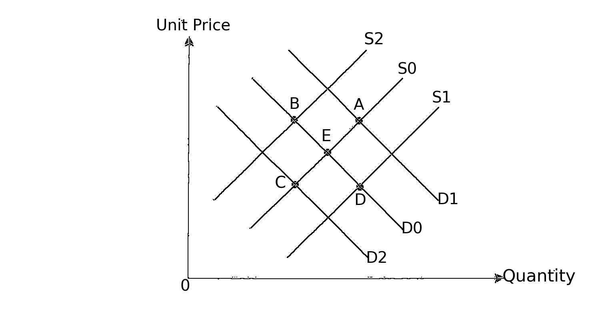

Suppose Good Y is an inferior good and the initial market equilibrium point is E. If there is a fall in the average income level of consumers, the new market equilibrium point will be \_\_\_\_\_\_.

- A. A
- B. B
- C. C
- D. D

---

## 第 15 題

【建議標籤】

- 卷別/部分：Paper 1
- 課題：#補貼 #稅負歸宿

【題目內容】

The following table shows the demand and supply schedules of a good.

| Price ($) | Quantity demanded (units) | Quantity supplied (units) |
|---|---|---|
| 20 | 70 | 40 |
| 22 | 60 | 45 |
| 24 | 50 | 50 |
| 26 | 40 | 55 |
| 28 | 30 | 60 |

If the government provides a $6$ per-unit subsidy for the producers of the good, the total subsidy provided by the government will be \_\_\_\_\_\_ and the ratio of consumers' share to producers' share of the subsidy will be \_\_\_\_\_\_.

- A. $300$ ...... $1:1$
- B. $300$ ...... $1:2$
- C. $360$ ...... $1:1$
- D. $360$ ...... $1:2$

---

## 第 16 題

【建議標籤】

- 卷別/部分：Paper 1
- 課題：#限額 #供求

【題目內容】

Refer to the following supply-demand diagram for the exported Chinese rare earth minerals.

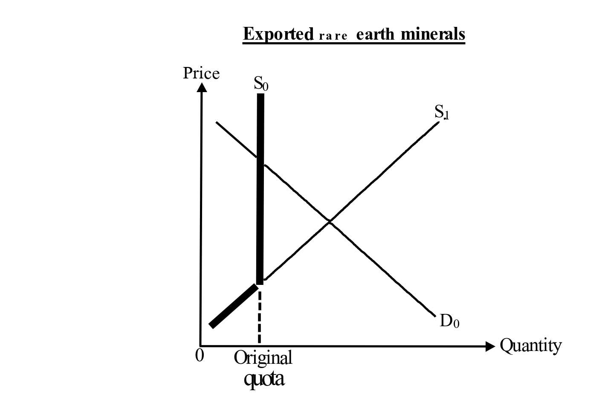

If China abolished the quota on the export of rare earth minerals,
(1) the export price of the rare earth minerals would drop.
(2) the export quantity of the rare earth minerals would rise.
(3) the total exchange value of the exported rare earth minerals would drop.

- A. (1) and (2) only
- B. (1) and (3) only
- C. (2) and (3) only
- D. (1), (2) and (3)

---

## 第 17 題

【建議標籤】

- 卷別/部分：Paper 1
- 課題：#彈性 #煙草稅

【題目內容】

A non-profit organisation supports the increase in cigarette tax. The organisation reveals that every 10% increase in cigarette prices reduces the total cigarette quantity transacted by 4%. Which of the following statements about cigarette tax is **INCORRECT**?

- A. Law of demand is illustrated in the above case.
- B. The total expenditure on cigarette will increase after the increase of the cigarette tax.
- C. The increase in cigarette tax may lead to a greater income inequality.
- D. The cigarette tax could help reduce the problem of under-production of cigarette.

---

## 第 18 題

【建議標籤】

- 卷別/部分：Paper 1
- 課題：#業務擴展 #垂直合併

【題目內容】

ABC Diamond Cutting Factories expand its business as follows:

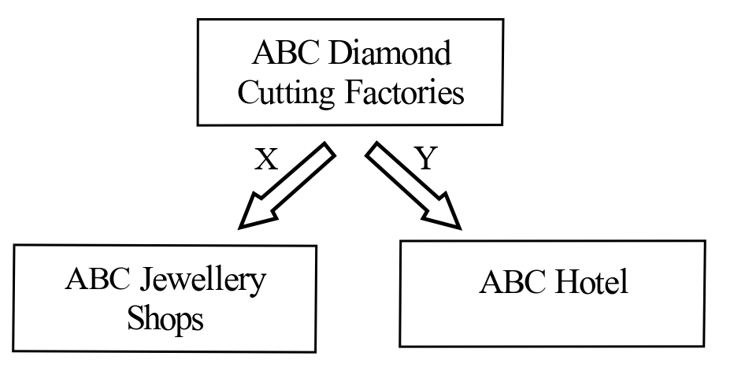

To ABC Diamond Cutting Factories, the types of expansion shown by X and Y are \_\_\_\_\_\_ expansion and \_\_\_\_\_\_ expansion respectively.

- A. backward ...... conglomerate
- B. backward ...... lateral
- C. forward ...... conglomerate
- D. forward ...... lateral

---

## 第 19 題

【建議標籤】

- 卷別/部分：Paper 1
- 課題：#價格上限 #無謂損失

【題目內容】

Study the following news extract.

> In the last decade, the rent of residential units in Berlin was doubled due to continuous increase in demand. To deal with the problem, the Berlin government imposed a 'Rent Frozen Bill' under which the rent of residential units was not allowed to increase for at least 5 years.

Suppose a similar bill is implemented in Hong Kong. Which of the following statements is correct?

- A. The Gini coefficient will increase.
- B. The property tax revenue of the government will increase.
- C. There will be a deadweight loss if the demand for residential units keeps on increasing.
- D. The property owners will have higher incentives to renovate their flats.

---

## 第 20 題

【建議標籤】

- 卷別/部分：Paper 1
- 課題：#價格下限 #無謂損失

【題目內容】

Refer to the following supply-demand diagram for Good X.

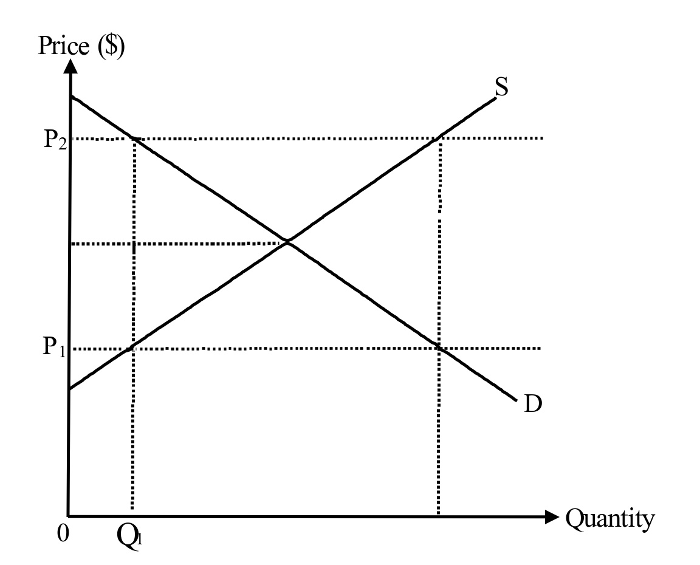

If the price floor of Good X changes from $P_1$ to $P_2$,

- A. producer surplus will increase.
- B. quantity transacted of Good X will remain at $Q_1$.
- C. deadweight loss will increase.
- D. excess demand of Good X will change to excess supply.

---

## 第 21 題

【建議標籤】

- 卷別/部分：Paper 1
- 課題：#界外效應 #私人解決

【題目內容】

With reference to the above information, which of the following statements is correct?

- A. Children screaming in the cafe results in negative externality and all cafes should introduce similar policy to restore efficiency.
- B. The extra charge on screaming children increases the marginal private cost of the groups with screaming children.
- C. The 'screaming child tax' is a government solution to the divergence between private and social costs.
- D. The 'screaming child tax' is a kind of discrimination and should not be imposed.

---

## 第 22 題

【建議標籤】

- 卷別/部分：Paper 1
- 課題：#羅倫茲曲線 #堅尼系數

【題目內容】

Study the following two Lorenz curves.

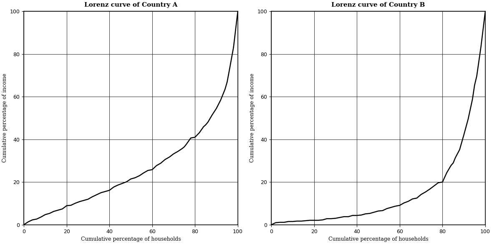

Compared with Country B,

- A. the Gini coefficient of Country A is larger.
- B. Country A has a higher standard of living.
- C. the top 20% of households in Country A have less total income.
- D. Country A has a more even income distribution.

---

## 第 23 題

【建議標籤】

- 卷別/部分：Paper 1
- 課題：#收入差距 #人力資本

【題目內容】

The following table shows the data of average annual income earned by women and men according to their age in 2018.

| Age | Average annual income of women (HK$) | Average annual income of men (HK$) |
|---|---|---|
| 20 – 29 | 122000 | 121000 |
| 50 – 59 | 482000 | 645000 |

Which of the following may explain the phenomena shown by the above data?
(1) Women tend to leave the job market earlier than men for taking care of the family, leading to fewer women to take up senior positions in companies.
(2) Sex discrimination in labour market exists in the older generations.
(3) Accumulation of human capital contributes to the difference in income between different age groups.

- A. (1) only
- B. (2) only
- C. (3) only
- D. (1), (2) and (3)

---

## 第 24 題

【建議標籤】

- 卷別/部分：Paper 1
- 課題：#失業 #就業不足

【題目內容】

The following table shows the employment data of Hong Kong from April to June in 2019.

| | Number of persons ('000) |
|---|---|
| Population | 7524 |
| Aged 15 or above | 6590 |
| Employed persons | 3871 |
| Unemployed persons | 114 |
| Underemployed persons | 41 |

According to the above data, the underemployment rate is \_\_\_\_\_\_.

- A. 0.55%
- B. 0.62%
- C. 1.03%
- D. 1.06%

---

## 第 25 題

【建議標籤】

- 卷別/部分：Paper 1
- 課題：#國民收入 #GDP

【題目內容】

Which of the following should be deducted from the gross domestic product of Hong Kong to calculate the gross national income of Hong Kong?

- A. the fee paid by a Hong Kong football club to a Japanese football team for an exhibition match in Hong Kong
- B. the rent earned by a Hong Kong property developer from its residential property in Japan
- C. the capital gain earned by a Japanese insurance corporation from its financial investment in Hong Kong
- D. the dividend paid by a listed company in Japan to a Hong Kong resident

---

## 第 26 題

【建議標籤】

- 卷別/部分：Paper 1
- 課題：#實質GDP #名義GDP

【題目內容】

The following diagram shows the gross domestic product (GDP) of Country A.

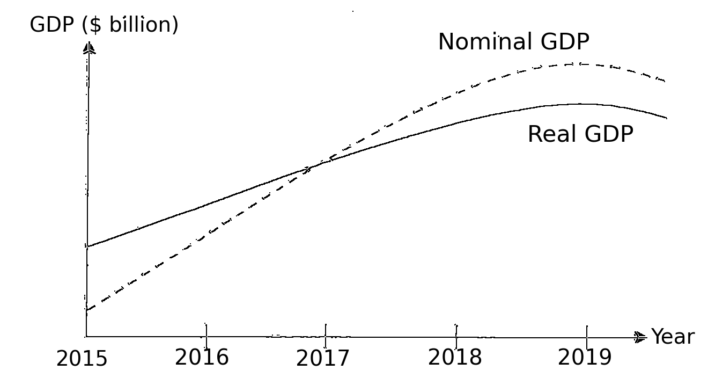

Which of the following statements about Country A is correct?

- A. The price level increased between 2016 and 2018.
- B. Deflation occurred before 2017.
- C. The actual inflation rate was equal to the expected inflation rate in 2017.
- D. The nominal GDP has been increasing since 2016.

---

## 第 27 題

【建議標籤】

- 卷別/部分：Paper 1
- 課題：#總供給 #SRAS

【題目內容】

Which of the following is a reason for a leftward shift of the short run aggregate supply curve in a country?

- A. There is a continuous increase in price level.
- B. The largest market of the country's exports suffers from an economic recession.
- C. More citizens emigrate to foreign countries.
- D. The wages of labour slowly adjust downward due to institutional factors.

---

## 第 28 題

【建議標籤】

- 卷別/部分：Paper 1
- 課題：#貨幣需求 #資產需求

【題目內容】

The following diagram shows the asset demand for money of an economy.

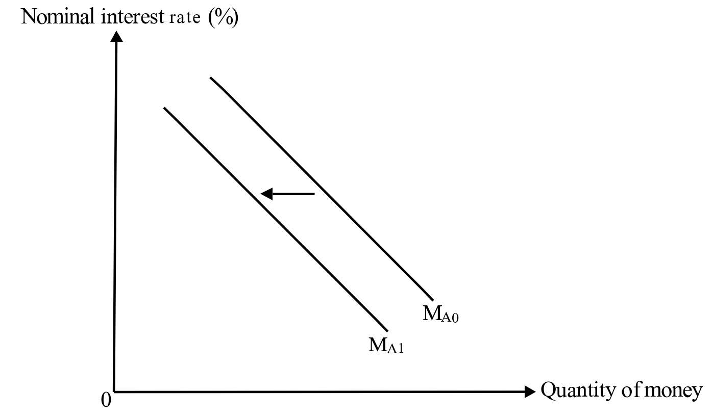

Which of the following will cause the above change in asset demand for money?

- A. The nominal interest rate increases.
- B. There is a contraction of monetary base.
- C. The use of electronic wallets such as Alipay（支付寶）becomes more popular.
- D. The expected rate of return of holding bonds increases.

---

## 第 29 題

【建議標籤】

- 卷別/部分：Paper 1
- 課題：#貨幣基礎 #貨幣供應

【題目內容】

The legal tender in Hong Kong held by licensed banks is included in \_\_\_\_\_\_.
(1) monetary base
(2) money supply M2
(3) money supply M3

- A. (1) only
- B. (2) only
- C. (2) and (3) only
- D. (1), (2) and (3)

---

## 第 30 題

【建議標籤】

- 卷別/部分：Paper 1
- 課題：#銀行乘數 #貨幣創造

【題目內容】

Refer to the following information about an economy. Suppose all banks do not hold any excess reserves.

| | $ million |
|---|---|
| Currency in public circulation | 10 |
| Monetary base | 30 |
| Money supply | 110 |

If the public deposits all the cash into the banking system,

- A. the actual banking multiplier will be 4.
- B. the maximum amount of loans will be $120$ million.
- C. the maximum amount of deposits will be $140$ million.
- D. the new money supply will be $160$ million.

---

## 乙部（第 31–45 題）

## 第 31 題

【建議標籤】

- 卷別/部分：Paper 1　乙部
- 課題：#貨幣市場 #利率

【題目內容】

The following diagram indicates the money supply curve ($M_s$) and money demand curve ($M_d$) of a certain economy. Suppose the initial equilibrium point is at E.

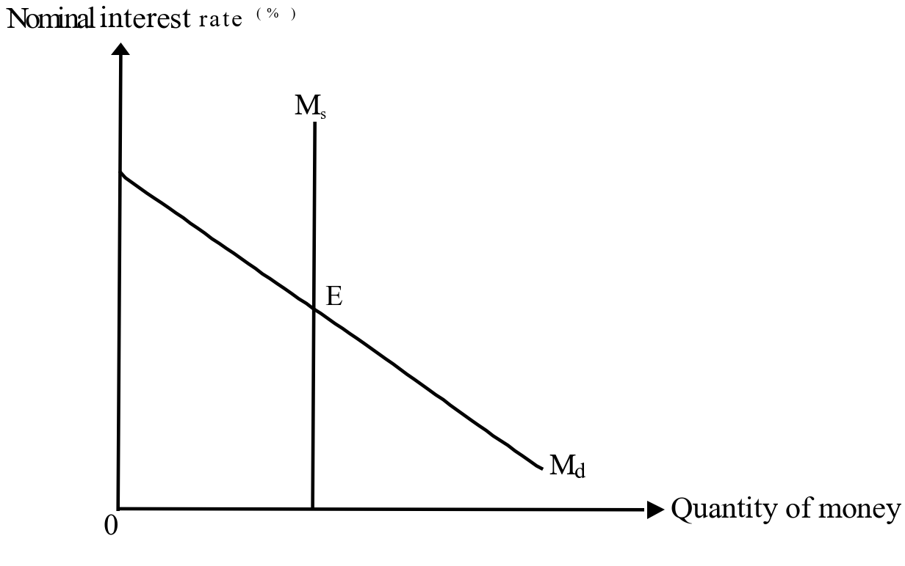

If the income of the public increases and the central bank sells government bonds to the public, the interest rate \_\_\_\_\_\_ and the quantity of money \_\_\_\_\_\_.

- A. will decrease ...... will increase
- B. will increase ...... may increase or decrease
- C. may increase or decrease ...... will decrease
- D. will increase ...... will decrease

---

## 第 32 題

【建議標籤】

- 卷別/部分：Paper 1
- 課題：#貨幣政策 #緊縮政策

【題目內容】

Which of the following is a contractionary monetary policy?

- A. an increase in the discount rate
- B. an increase in the salaries tax rate
- C. a decrease in the required reserve ratio
- D. a decrease in the quota for migration

---

## 第 33 題

【建議標籤】

- 卷別/部分：Paper 1
- 課題：#銀行乘數 #現金流失

【題目內容】

Which of the following will increase the actual banking multiplier?

- A. The public tends to hold more cash.
- B. The use of credit card becomes more popular.
- C. The central bank increases the required reserve ratio.
- D. The interest rate of bank deposit decreases.

---

## 第 34 題

【建議標籤】

- 卷別/部分：Paper 1
- 課題：#通脹 #財富再分配

【題目內容】

When there is unexpected inflation, which of the following persons will gain?

- A. a landlord who adjusts his rental according to the price index
- B. a creditor who has loaned out a sum of money at a floating interest rate
- C. an employer who signs a fixed nominal wage contract with his employees
- D. a retired civil servant who receives a fixed monthly pension

---

## 第 35 題

【建議標籤】

- 卷別/部分：Paper 1
- 課題：#財政政策 #總需求

【題目內容】

Which of the following policies would offset the effect of an increase in the willingness to invest on the price level?
(1) an increase in profits tax rate
(2) an increase in transfer payment
(3) a decrease in tax allowance

- A. (1) and (2) only
- B. (1) and (3) only
- C. (2) and (3) only
- D. (1), (2) and (3)

---

## 第 36 題

【建議標籤】

- 卷別/部分：Paper 1
- 課題：#AD-AS #通縮缺口

【題目內容】

The diagram below shows the aggregate demand curve, the short run aggregate supply curve and the long run aggregate supply curve of an economy.

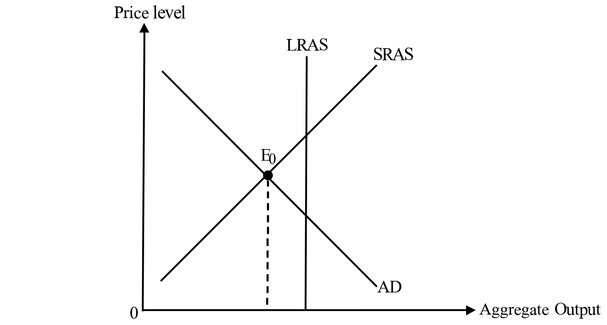

Suppose the economy initially operates at $E_0$ and the total import value equals to the total export value. If the government decreases the amount of social security assistance for the elderly, in the short run, the deflationary (output) gap will become \_\_\_\_\_\_ and there will be a \_\_\_\_\_\_.

- A. narrower ...... trade surplus
- B. narrower ...... trade deficit
- C. wider ...... trade surplus
- D. wider ...... trade deficit

---

## 第 37 題

【建議標籤】

- 卷別/部分：Paper 1
- 課題：#穩定政策 #貨幣政策

【題目內容】

An economist said, 'The continuous fall in stock prices in our country has already affected the consumption expenditure as well as the money demand. We should implement a policy to relieve the effects on the output level and the interest rate.' Which of the following policies can stabilise the output level and the interest rate in the country at the same time in the short run?
(Assume the interest rate is mainly affected by the asset demand for money in this case.)

- A. The government increases cash subsidy to the poor.
- B. The government gives tariff exemption to the imports of goods.
- C. The central bank instructs the commercial banks to tighten the requirement of personal loans.
- D. The central bank buys government bonds from the public.

---

## 第 38 題

【建議標籤】

- 卷別/部分：Paper 1
- 課題：#銷售稅 #收入分配

【題目內容】

In 2019, the Japanese government increases the general sales tax rate on most of the goods and services from 8% to 10%. As a result,
(1) income inequality will be higher.
(2) the fiscal deficit will be eliminated.
(3) the invisible trade deficit will decrease.

- A. (1) only
- B. (2) only
- C. (3) only
- D. (1), (2) and (3)

---

## 第 39 題

【建議標籤】

- 卷別/部分：Paper 1
- 課題：#稅務原則 #亞當斯密

【題目內容】

The following is an extract of the mission of the Inland Revenue Department.

> Our Mission
>
> We are committed to
>
> - collecting revenue efficiently and cost-effectively
> - enabling staff to acquire the necessary knowledge, skills and attitude so that they can contribute their best to the achievement of our vision

The above mission is in line with the \_\_\_\_\_\_ principle of taxation put forward by Adam Smith.

- A. equality
- B. certainty
- C. convenience
- D. economy

---

## 第 40 題

【建議標籤】

- 卷別/部分：Paper 1
- 課題：#香港稅制 #稅種

【題目內容】

Mr. Chan runs a factory in mainland China and earns a huge profit. Recently he has bought a flat and a second hand electric car in Hong Kong, and received dividends from his shares of HSBC.

According to the above information, which type(s) of tax does he need to pay to the Hong Kong government?
(1) Property tax
(2) Stamp duty
(3) Profits tax
(4) First registration tax

- A. (2) only
- B. (1) and (4) only
- C. (2) and (3) only
- D. (1), (3) and (4) only

---

## 第 41 題

【建議標籤】

- 卷別/部分：Paper 1
- 課題：#稅務寬免 #所得稅

【題目內容】

In the case **WITHOUT** tax exemption, John needs to pay $15\,000$ and Mary needs to pay $35\,000$ as income tax.

Suppose the government proposes the following income tax exemption measures:

| | Amount of tax exemption |
|---|---|
| Measure I | 75% of income tax, maximum $30\,000$ |
| Measure II | 100% of income tax, maximum $20\,000$ |

John will prefer \_\_\_\_\_\_ while Mary will prefer \_\_\_\_\_\_.

- A. measure I ...... measure I
- B. measure I ...... measure II
- C. measure II ...... measure I
- D. measure II ...... measure II

---

## 第 42 題

【建議標籤】

- 卷別/部分：Paper 1
- 課題：#比較優勢 #貿易得益

【題目內容】

The following table shows the amounts of consumption on two goods in Country A and Country B before international trade. Assume both countries use one unit of resources on producing Good X and one unit of resources on producing Good Y.

<table>
<tr><th></th><th colspan="3">Consumption before trade (units)</th></tr>
<tr><th></th><th>Good X</th><th></th><th>Good Y</th></tr>
<tr><td>Country A</td><td>100</td><td>and</td><td>25</td></tr>
<tr><td>Country B</td><td>80</td><td>and</td><td>40</td></tr>
</table>

If Country A and Country B completely specialise their production and trade with each other, the total output of both countries will increase by \_\_\_\_\_\_ units of Good X and \_\_\_\_\_\_ units of Good Y.

- A. 15 ...... 15
- B. 15 ...... 20
- C. 20 ...... 15
- D. 20 ...... 20

---

## 第 43 題

【建議標籤】

- 卷別/部分：Paper 1
- 課題：#開放經濟 #進口

【題目內容】

The diagram below shows the market situation of Good X in a small open economy.

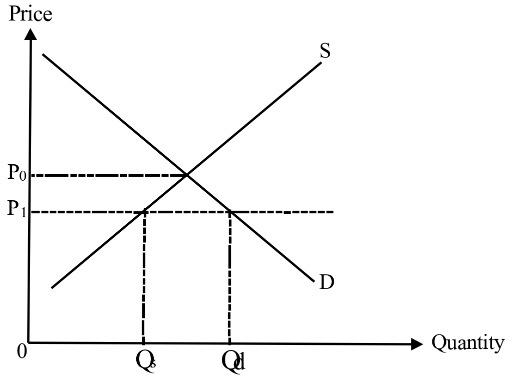

$P_0$ is the price before trade and $P_1$ is the price after trade. Which of the following statements about Good X are correct after the economy opens up for international trade?
(1) The total expenditure on Good X of domestic consumers would be $P_1\times Q_d$.
(2) The value of domestically produced Good X would be $P_1\times Q_s$.
(3) The shortage of Good X would be $Q_d-Q_s$.

- A. (1) and (2) only
- B. (1) and (3) only
- C. (2) and (3) only
- D. (1), (2) and (3)

---

## 第 44 題

【建議標籤】

- 卷別/部分：Paper 1
- 課題：#匯率 #國際貿易

【題目內容】

The following table shows the change in the exchange rate of Euro against the US dollar.

| Date | Exchange rate |
|---|---|
| 22 September 2018 | 1 EUR = US$ 1.176 |
| 22 August 2019 | 1 EUR = US$ 1.109 |

The above change in the exchange rate will lead to a decrease in

- A. the number of European tourists visiting the US.
- B. the volume of goods exported from Europe to the US.
- C. the total value of US exports to Europe (in terms of Euro).
- D. the total value of European exports to the US (in term of the US dollar).

---

## 第 45 題

【建議標籤】

- 卷別/部分：Paper 1
- 課題：#聯繫匯率 #香港貨幣

【題目內容】

Under the linked exchange rate system of Hong Kong, which of the following statements is correct?

- A. The money supply M1 of Hong Kong has to be fully backed up by the US dollar.
- B. Hong Kong's export volume will increase when the US dollar depreciates against other currencies.
- C. The market exchange rate of the HK dollar relative to the US dollar is fixed.
- D. Hong Kong citizens can sell 1 USD to the three note-issuing banks for 7.8 HKD.

---
